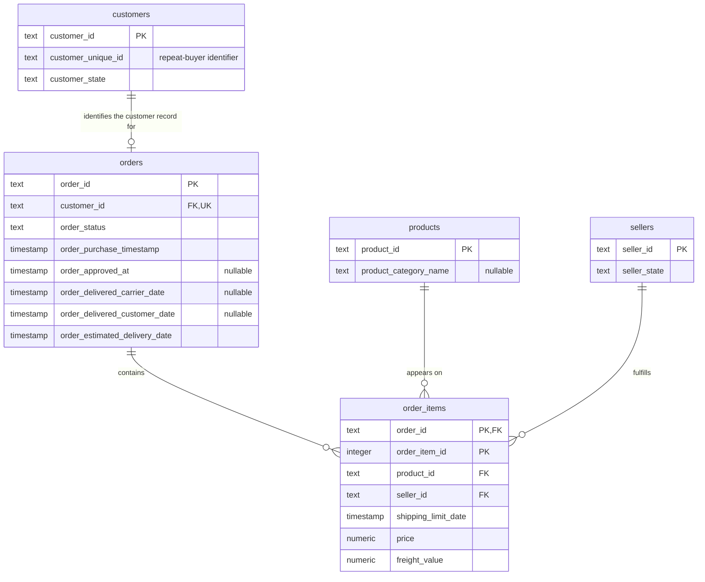

# Olist source ERD

An order records the purchase. An order item records one numbered line in that order and links to the product and the seller assigned to fulfill the line.

- **PK** identifies a row. The item primary key combines `order_id` and `order_item_id`. Item numbers can repeat across different orders.
- **FK** points to a row in another table. Every order has one customer record. Every item has one order, one product, and one seller. All four foreign keys are required.
- **UK** means unique. `orders.customer_id` can appear in at most one order. A buyer's `customers.customer_unique_id` can appear in several customer records.
- One order can have zero or many item lines. A product or seller can appear on zero or many lines. The item table connects orders and products in a many-to-many relationship and records the seller of each occurrence. An order can repeat a product or use multiple sellers without losing line detail.

See the [design note](design_note.md) for the key choices and missing-data rules.
